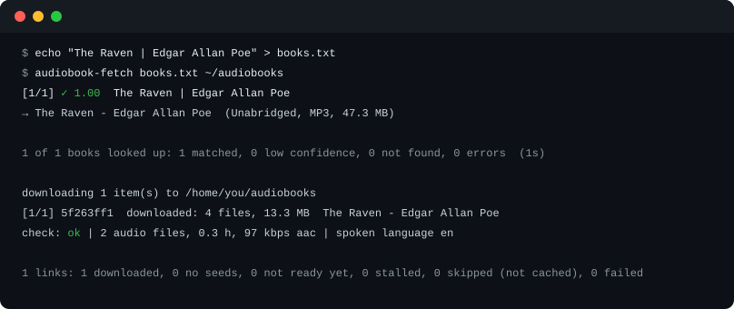

# audiobook-fetch

[](https://github.com/broots144/audiobook-fetch/actions/workflows/ci.yml)
[](LICENSE)

Give it a list of audiobooks and a folder. It finds each one, picks the best
edition on its own, downloads the files into the folder, unpacks them if they
came as an archive, and checks that what arrived really is that book.

```sh
audiobook-fetch books.txt /path/to/folder
```

> [!IMPORTANT]
> **Only use this for audiobooks you are legally allowed to acquire**: works
> in the public domain, works whose rights holder permits free distribution,
> or anything else you have the right to download where you live.
>
> The tool automates searching and downloading. It cannot tell what you are
> entitled to, and it does not try to. That is your responsibility, as is
> following the law where you live and the terms of every service it talks
> to. The authors do not condone copyright infringement and accept no
> liability for how the tool is used (see [LICENSE](LICENSE)). It is not
> affiliated with any site or service it can search or download through.

**Free to try, no account.** Public-domain books are found in the
[Internet Archive](https://archive.org/details/librivoxaudio)'s LibriVox
collection and downloaded straight from it. Everything else it can search
needs a [TorBox](https://torbox.app) account to download through; `find`,
`check` and `tidy` never need one.

**Built from plugins.** Where it searches (a *source*) and what fetches the
links (a *downloader*) are both small plugins behind a Go interface. Four
sources and two downloaders ship with it, and adding your own is one
package: see [Extending](docs/extending.md).

## What a run looks like

A public-domain book, on a machine with no account and no config:



<details>
<summary>The same run as text</summary>

```console
$ echo "The Raven | Edgar Allan Poe" > books.txt
$ audiobook-fetch books.txt ~/audiobooks
[1/1] ✓ 1.00  The Raven | Edgar Allan Poe
        → The Raven - Edgar Allan Poe  (Unabridged, MP3, 47.3 MB)

1 of 1 books looked up: 1 matched, 0 low confidence, 0 not found, 0 errors  (1s)

downloading 1 item(s) to /home/you/audiobooks
[1/1] 5f263ff1  downloaded: 4 files, 13.3 MB  The Raven - Edgar Allan Poe
        check: ok | 2 audio files, 0.3 h, 97 kbps aac | spoken language en

1 links: 1 downloaded, 0 no seeds, 0 not ready yet, 0 stalled, 0 skipped (not cached), 0 failed
```

</details>

The score (0 to 1) is how sure the match is; the `check:` line is what
listening to the files found.

## What it is not

- **Not a library server or a player.** It puts checked files in a folder
  and stops. Something like [Audiobookshelf](https://www.audiobookshelf.org)
  or Plex is what serves and plays them; point it at the same folder.
- **Not a Readarr replacement.** Readarr, [retired in
  2025](https://github.com/Readarr/Readarr), was a server that watched
  authors and grabbed new releases as they appeared. This is a command you
  run with a list: no server, no database, nothing to keep running. It does
  not watch for new books. What it does that Readarr did not is listen to
  what arrived and throw out what is not the book.
- **Not a torrent client.** It never joins a swarm. Links are handed to a
  downloader, which gives back plain files over HTTPS.

## Quick start

1. **Install it.** With Homebrew, on macOS or Linux:

   ```sh
   brew install broots144/tap/audiobook-fetch
   ```

   Or download the binary for macOS, Linux or Windows from the
   [releases page](https://github.com/broots144/audiobook-fetch/releases),
   unpack it and put `audiobook-fetch` somewhere on your `PATH`. Each release
   has checksums and build provenance. Or build it with Go 1.27 or newer:

   ```sh
   go install github.com/broots144/audiobook-fetch/cmd/audiobook-fetch@latest
   ```

2. **Write a list**, one book per line (see [`books.example.txt`](books.example.txt)):

   ```
   Pride and Prejudice | Jane Austen
   Frankenstein | Mary Shelley
   ```

3. **Run it:**

   ```sh
   audiobook-fetch books.txt /path/to/folder
   ```

   Books with a confident match are downloaded. The rest are listed in
   `/path/to/folder/.audiobook-fetch/results.csv` for you to look at. Running
   the same command again is always safe: it picks up where it stopped.

4. **For books that are not in the Internet Archive**, add a downloader key.
   Those go through [TorBox](https://torbox.app), so you need an account
   there. Put its API key in `~/.config/audiobook-fetch/torbox.key` and
   `chmod 600` it, or set `TORBOX_API_KEY`.

**Is it set up right?** `audiobook-fetch doctor` checks the key, the folder
and the optional programs, and says how to fix whatever is missing.

**Optional, recommended:** install `ffmpeg` and `whisper-cpp` (both are in
Homebrew and most package managers) and put a whisper.cpp model such as
[`ggml-base.bin`](https://huggingface.co/ggerganov/whisper.cpp/tree/main)
(about 150 MB) in `~/.config/audiobook-fetch/models/`. Each download's
audio is then [checked](docs/behaviour.md#checking-what-came-down): playable, spoken language,
abridged or dramatized. Zip archives are unpacked without anything extra; for
rar and 7z, install one of `7zz`, `7z`, `unar` or `bsdtar` (macOS has
`bsdtar` already).

## Contents

- [The list](#the-list): what a line can look like
- [What happens](#what-happens) and [how it picks](#how-it-picks)
- [Options](#options) and the [config file](#config-file)
- [What it does with a download](#what-it-does-with-a-download), and in full: [docs/behaviour.md](docs/behaviour.md)
- [The parts on their own](#the-parts-on-their-own): `find`, `download`, `check`, `tidy`, `doctor`
- [Extending](docs/extending.md): the source and downloader plugins, and use from Go
- [What it is not](#what-it-is-not)
- [Contributing](CONTRIBUTING.md), [code of conduct](CODE_OF_CONDUCT.md), [security](SECURITY.md), [changelog](CHANGELOG.md), [license](#license)
- Questions and ideas: [Discussions](https://github.com/broots144/audiobook-fetch/discussions)

## The list

One book per line. Any of these work, and they can be mixed:

```
Title | Author
Title by Author
Title - Author
Just A Title
magnet:?xt=urn:btih:...
# a comment
```

An author makes matches far more reliable. Lines without an explicit `|` are
read as best they can be, and if the first reading finds nothing good the
other readings are tried (so `Author - Title` works too). Bullets and
numbering in front of a line are ignored. A magnet link skips the search and
goes straight to download.

Exports work as well: CSV or TSV with a header row naming a title column
(`Title`, `Author` and similar), and JSON as an array of strings or of
objects with `title` and `author`. Use `-` to read the list from stdin.

## What happens

1. **Find.** Each book is searched for and every listing is scored. The top
   few have their own pages read, then the best is chosen.
2. **Download.** Each chosen link is handed to the downloader. When it has
   the files, they are saved under the folder, a few at a time.
3. **Report.** `results.csv` in the folder's `.audiobook-fetch/` subfolder
   lists every line of the list: what was picked, where from, how confident
   the match was, and whether it downloaded.

Books without a confident match are **not** downloaded; they are listed in
the report for you to check. Add `-include-low` to accept them anyway.

Running the same command again is always safe and picks up where it stopped:
books already matched are not searched again, links already with the
downloader are not added twice, finished files are skipped, and partial files
continue. Add new lines to the list and run again to fetch just those.

## How it picks

Each listing gets a score from 0 to 1:

- **Title, 70%.** Word overlap plus spelling similarity, tolerant of
  subtitles, series prefixes, accents and small typos.
- **Author, 30%.** Surname counts most; initials are ignored. A listing that
  names no author is judged on its title, a little cautiously.
- **Language.** Only English listings are considered (`-lang` changes this).
- **Penalties.** Abridged editions, summaries and study guides,
  dramatizations, bundles, and a volume number that wasn't asked for.
- **Audio quality.** Among listings that match equally well, the best
  sounding wins: bitrate, weighted by format, so M4B beats MP3 at the same
  bitrate.

A pick scoring 0.75 or more counts as a match (`-min-score`).

## Options

`audiobook-fetch -h` lists everything. The ones that matter most:

| Option | Default | |
|--------|---------|--|
| `-remove-after` | off | remove each item from the downloader once its files are here |
| `-cached-only` | off | skip links the downloader would have to fetch first |
| `-include-low` | off | also accept low-confidence matches |
| `-lang NAME` | `english` | wanted language, or `any` |
| `-source NAMES` | `archive,audiobookbay,knaben` | where to search, comma-separated, in the order to try |
| `-downloader NAME` | `torbox` | which service fetches the links |
| `-delay D` | `3s` | pause between requests to a source |
| `-search-proxy URL` | none | send searches through a proxy |
| `-wait D` | `1h` | how long to wait for the downloader to fetch what it lacks |
| `-stall-after D` | `5m` | give up on a link the downloader makes no progress on for this long (`0` keeps waiting) |
| `-parallel N` | `3` | files to download at once |
| `-fresh` | off | search every book again, ignoring earlier matches |
| `-redo` | off | download links again even if an earlier run completed or rejected them |
| `-check` | on | check each download's audio once it is here (`-check=false` turns it off) |
| `-whisper-model FILE` | see below | whisper.cpp model used to listen to samples |
| `-unpack` | on | unpack zip, rar and 7z archives once downloaded, then delete them |
| `-keep-one-format` | on | when a download holds the same book in several formats, keep the best and move the rest aside |
| `-quiet` | off | only print the summaries |

### Config file

To avoid typing the folder and options every time, create
`~/.config/audiobook-fetch/config.json`:

```json
{
  "to": "/path/to/audiobooks",
  "remove_after": true,
  "sources": ["archive", "audiobookbay", "knaben"],
  "downloader": "torbox",
  "search_proxy": "",
  "check": true,
  "whisper_model": "/path/to/ggml-base.bin",
  "unpack": true,
  "keep_one_format": true
}
```

Every key is optional. With `to` set, `audiobook-fetch books.txt` is the
whole command.

The config folder is `~/.config/audiobook-fetch` on macOS and Linux and
`%AppData%\audiobook-fetch` on Windows; `XDG_CONFIG_HOME` is honoured when
set. Key files and whisper models live in the same folder. The tool is
tested on all three systems.

## What it does with a download

Each of these is on by default and explained in full in
[docs/behaviour.md](docs/behaviour.md):

- **Unpacks archives.** A book that arrives as a zip, rar or 7z is unpacked
  and the archive deleted ([more](docs/behaviour.md#archives)).
- **Checks the audio.** Playable, bitrate, spoken language, abridged or
  dramatized. What is not the book is moved aside and the next-best listing
  tried ([more](docs/behaviour.md#checking-what-came-down)).
- **Keeps one format.** A book that came as an M4B and again as MP3s is cut
  down to the best; the rest are moved aside, not deleted
  ([more](docs/behaviour.md#the-same-book-in-several-formats)).
- **Gives up on dead links.** A link nobody is seeding is dropped for the
  book's next-best listing ([more](docs/behaviour.md#links-with-no-seeds)).
- **Picks the right downloader.** Internet Archive books come straight from
  the Archive; everything else goes through TorBox
  ([more](docs/behaviour.md#sources)).

## The parts on their own

```sh
audiobook-fetch find books.txt                  # only find links; writes results/
audiobook-fetch download magnets.txt /folder    # only download links you already have
audiobook-fetch check /folder                   # only check books already downloaded
audiobook-fetch tidy /folder                    # unpack archives and drop duplicate formats there
audiobook-fetch doctor                          # check the setup and say what is missing
audiobook-fetch version
```

`find` writes `magnets.txt` (one link per confident match), `results.csv` and
`results.json`. `download` takes any file of magnet links. `check` treats each
subfolder as one book and prints a verdict for each (`-json` for machines); it
moves and deletes nothing, and exits non-zero if it would reject any.

`tidy` does for books already in a folder what a download gets on arrival:
[archives](docs/behaviour.md#archives) are unpacked and deleted, and a book held in
[several formats](docs/behaviour.md#the-same-book-in-several-formats) is cut down to the best,
with the others moved to the folder's `.audiobook-fetch/duplicates/`. Try it
with `-dry-run` first to see what it would do, and use `-book NAME` to tidy
only the folders whose name contains NAME.

**Stopping.** Ctrl-C stops a run cleanly: downloads in flight keep what
they have, and the same command carries on where it left off. Press it twice
to stop at once.

**Exit codes.** `0`: done. `130`: stopped with Ctrl-C. `1`: something needs attention (a download
failed, searching stopped early, `check` would reject a book, `doctor` found
something missing, or there was nothing to do). `2`: the command line was
wrong.

## Extending

Sources and downloaders are plugins: one Go package each, behind a small
interface. [docs/extending.md](docs/extending.md) shows the interfaces, which
existing package to copy, and how to use the whole thing as a Go library.

## Contributing

Bug reports and pull requests are welcome. [CONTRIBUTING.md](CONTRIBUTING.md)
covers how the code is laid out, how to run the tests, and what a change
needs before it can be merged.

## Security

What the tool trusts and what it does not is written down in
[SECURITY.md](SECURITY.md), along with how to report a problem.

## License

[MIT](LICENSE). The software is provided as is, without warranty of any kind.
